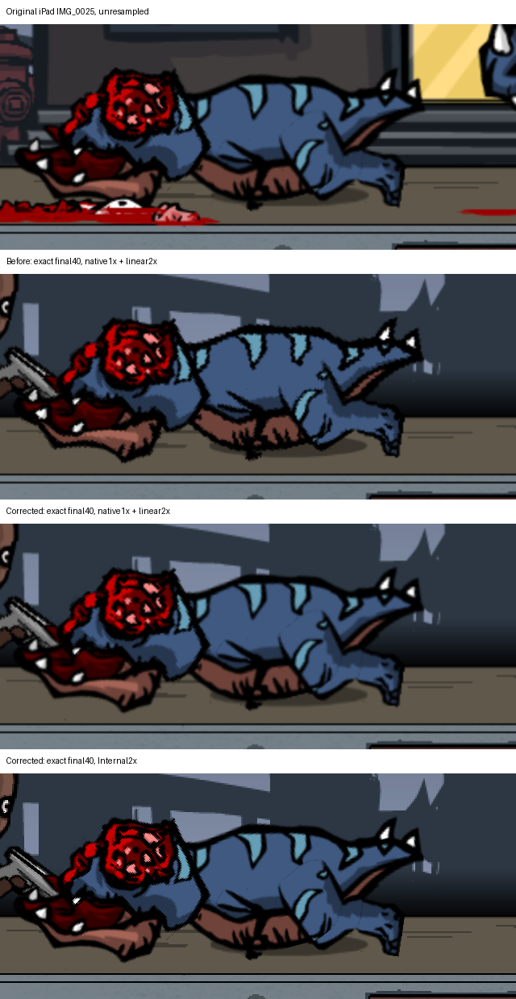

# Fidelity: shipped quirks kept, and every place the port differs

> *AI-reviewed content: may change at any time and should not be fully trusted. See the [disclaimer](../start/disclaimer.md).*

> **In simple terms.** Where the original does something odd, the port does the same odd thing on purpose. Where the
> port differs from the original, it is listed here with its reason, so nobody mistakes an extra for the original or
> "fixes" an original quirk by accident.

## 1. Original quirks kept (SOURCE_FAITHFUL)

| Quirk | Where explained |
|---|---|
| Camera jumps one frame when you turn away from a world edge it is pinned to (seen on iPad and Android) | [Combat controls](../how-it-works/05-combat-controls.md) |
| Bazooka firing overlaps the house enter animation | same |
| Shots and death sounds drop at intervals during sustained automatic fire (28-sound cap) | [Sound](../how-it-works/04-sound.md) |
| Held button, not queued taps: a tap during a swing is ignored; a new press made during a swing repeats it only if held through completion (holding the original successful press alone does not repeat) | combat controls |
| Holding melee from the very first instant does not repeat after a bite (flag cleared at swing start) | combat controls |
| Type-4 dinosaur effectively never spawns: a 9999 s timer armed at 151 s gives an ideal deadline of 10150 s (about 2 h 49 min), so it is reachable | [Jungle Blitz](../how-it-works/10-jungle-blitz.md) |
| Level number and save advance when leaving the shop, not entering it | [Saves](../how-it-works/07-saves-and-progression.md) |
| Menu keeps the paused picture for about a second after choosing Menu | [Pause](../how-it-works/08-pause-and-time.md) |
| Door icon acts on release inside its rectangle, not on press | combat controls |
| Thin black lines on dinosaur and player limbs, some appearing in mid-air attached to the models, are original-game defects. They are reproduced at native 1X, not hidden or repainted (see section 3) | section 3 |
| Dinosaur art files do not match the type numbers | [Dinosaurs](../how-it-works/06-dinosaurs-and-spawning.md) |

## 2. Where the port differs (with classification)

| Difference | Class | Original contract | Reversible |
|---|---|---|---|
| Mouse and keyboard act as a synthetic finger and extra key bindings | Platform adapter | Touch screen only | Yes |
| Widescreen expansion beyond 4:3 | Platform adapter / port policy | Fixed 1024 × 768 | Setting |
| Camera catch-up speed scaled with width at wide aspect ratios | Platform adapter | Fixed catch-up speed | Yes |
| Internal 2X framebuffer (requested internal scale) | Modern visual enhancement | 1X framebuffer | Player setting |
| Display-height cap on the 2X target on mobile (actual density can be below 2X) | Platform adapter | n/a | Code-level; desktop 2X is not capped |
| 60 fps frame pacing on mobile | Platform adapter | Original engine tick | Code-level |
| Smooth / Original output scaling option | Presentation choice | Native sampling is mixed per sheet (one dinosaur sheet linear, others nearest); whether the original's final output had any filter is not verified | Setting |
| Original weapon ranges kept on expanded views (targets visible but out of range can exist) | Source-faithful (accepted port-policy consequence) | Range in 1024-wide space | No extension was ever implemented, so nothing to reverse |
| Esc maps to Back / pause | Platform adapter | No keyboard | Yes |
| Mouse wheel changes weapon once per gesture | Platform adapter | No wheel | Yes |
| Debug tools present in every build, off by default | Debug only | None | Switch |
| JSON file saves (`dinocap-save.json`), legacy preference import, reset-all, debug save/progression policy | Platform adapter | Raw binary `dinocap.sav` | Code-level |
| Shop table lower-edge pixel exclusion (an attempted defensive workaround; **it did not remove the artifact**: the owner's re-check shows the extra edge row is still visible, and the earlier acceptance relied on report images that did not match the device; the original GPU mechanism is UNKNOWN) | Attempted workaround, unresolved; **known remaining difference (leftover)** | Original shop table without the extra row | Code-level; not pursued by owner decision |
| Extra left background/foreground tile in Jungle on expanded views (physical multi-monitor spanning untested) | Accepted defensive coverage adapter | Native Jungle: three 1023-wide copies per layer with native wrapping (City's four-tile capacity is a different baseline) | Code-level |
| Non-crashing K4 laser binding: 11 original skeletal frames bound to the existing K4 rig and phase; the original playable effect was never observed and is not claimed to be recovered | User-authorized compatibility repair | A native assertion on a missing sequence (not proven to be an observed crash) | Code change with crash implications |
| Offline: no Game Center, no score submission | Platform limitation | Online service | n/a |

## 3. The thin black lines (original defect, reintroduced on purpose)

The owner observed thin black lines on dinosaur and player limbs, some appearing in mid-air attached to the models, on
the original game. Several different explanations were tried over time and should not be merged into one:

- Task025D proposed a native shadow-rim identity for a line, Task025E a ground-rim identity; Task025F retired both,
  inferred that one particular actor-associated line was a Unity raster artifact and gave no instruction to restore it.
- Separately, earlier imports used hard (nearest) sampling with no mip-maps, uncompressed, with anti-aliasing off, which
  also removed dark seams. Pixelation of close-ups from point presentation was discussed in Task025F.
- N2.52 then found native loader evidence that the main dinosaur sheet is sampled **linear** (the second sheet and the UI
  nearest) and restored that mixed sampling, with the owner's permission. The lines appeared again.

*Figure 02. Top: an original iPad screenshot (unresampled). Below: the port before the sampling correction, after it (native 1X with a linear 2X display scale), and with Internal 2X. Note the thin black outline lines on the original and on the corrected port. Source: N2.52 native linear sampling fix (existing report image; not newly captured).*

The owner judged the corrected native 1X appearance the closest to the iPad and accepted it, including the retained
defects: "being identical also means carrying over the original game defects." Policy: do not hide, inset UVs, repaint or
blur them.

What is **not** established: that the earlier line theories (D, E, F) are the same thing as every limb or floating line;
that hiding the lines alone caused the pixelated look; exact image or moving-edge equality with the iPad (the fix record
says differing pose and background crops are not pixel-equality tests); and any claim for Internal 2X, which is not
claimed identical or line-free. The owner recalls the lines disappearing under some conditions but no longer remembers
the details, so those conditions are **not recorded** (unknown). Registry: `render.dino1.thin_black_line_defects_preserved`.

## 4. What "proven" means here

A contract is **PROVEN** only for the exact claim the evidence shows. A recovered mechanism can be proven while a side
branch stays LIKELY or UNRESOLVED; the registry keeps these separate. Open items are not hidden:

- the original-device impression that fewer dinosaurs are on screen than the model predicts;
- the one-slot music/effects budget difference in the sound cap;
- the Jungle controls per key;
- the F2 (flamethrower) and F3 (laser) device-acceptance rows (the parent investigation is still open);
- a pause pose observation the owner chose not to pursue;
- the shop table lower-edge artifact, still visible, left as a known remaining difference;
- debug-only: Back may not dismiss the soft keyboard in debug number fields on one tested Android phone and keyboard (not pursued).

## 5. Evidence pointers

Registry: `port.policy.*`, `citygrind.presentation_aspect_mode.*`, `camera.follow.*`, `presentation.*`; policy file
sections 11.2–11.4 (divergence classification).
