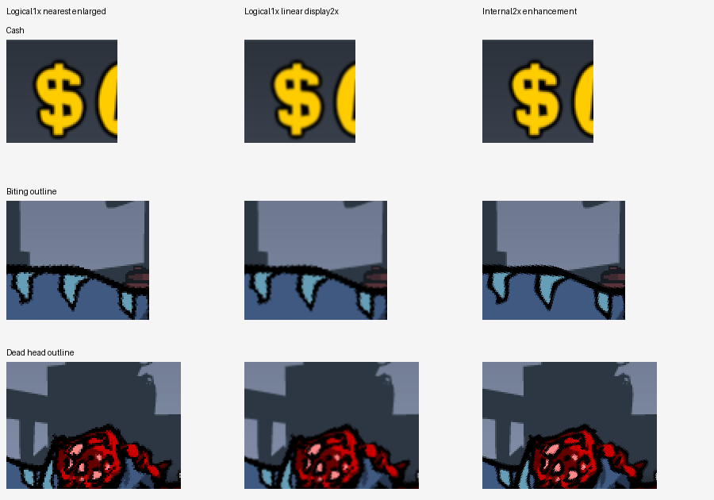
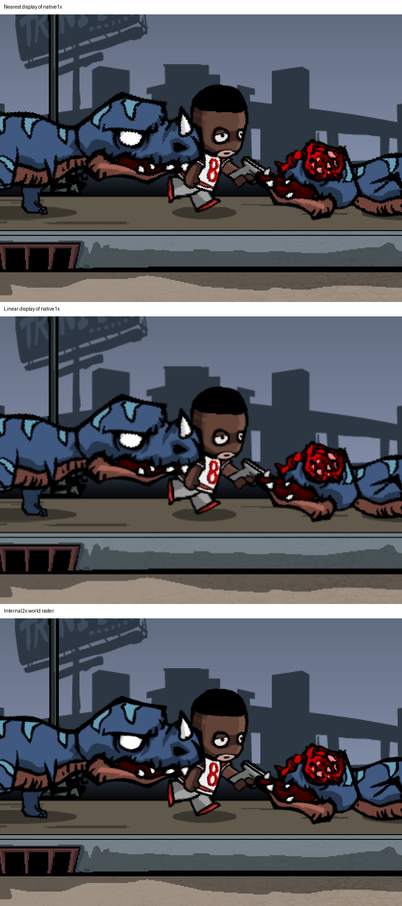
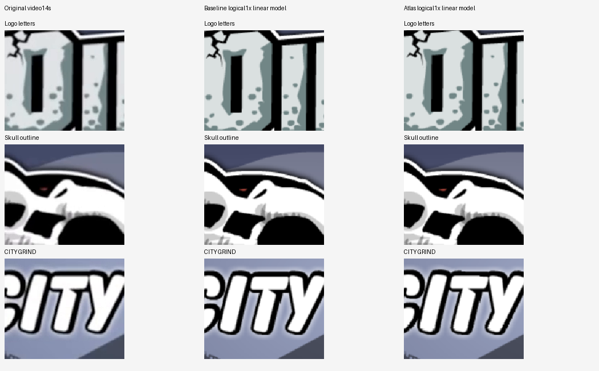

# 3. How the picture reaches your screen

> *AI-reviewed content: may change at any time and should not be fully trusted. See the [disclaimer](../start/disclaimer.md).*

> **In simple terms.** The original game draws on a fixed 1024 × 768 canvas (the iPad's shape). The port can show that
> canvas exactly as it was ("1X"), draw it sharper at double the pixels ("Internal 2X"), and stretch the picture to a
> wider window or phone ("widescreen"). Only the first is the original's behaviour; the others are deliberate port
> choices, and the documentation keeps them labelled that way.

## 3.1 The original canvas

- The game's logical view is **1024 × 768**, 4:3. The camera follows the player sideways only; the full height is
  always visible.
- Pictures are drawn as flat quads using the atlas rectangles from chapter 2. Different sheets use different filtering:
  the main dinosaur sheet is sampled **linear** (soft), while the second dinosaur sheet and the UI are sampled
  **nearest** (hard-edged). The port reproduces this mix instead of applying one filter to everything.
- Grounded actors use a fixed formula: the root height of the player and dinosaurs on iPad derives as
  `-104 + 240 = 136.0` with a single uniform scale of 1.0, and ground settling does not alter it. Airborne states, jumps,
  landings and death effects have their own motion rules.

## 3.2 Presentation modes in the port

| Setting | What it does | Classification |
|---|---|---|
| Internal 1X | Renders the 1024 × 768 framebuffer at native density | Source-faithful |
| Internal 2X | Renders the same scene at up to double density; on mobile the target is capped to the display height, so the real density can be lower | Modern visual enhancement |
| Smooth / Original (output scaling) | Smooth scales the finished frame softly to the window; Original uses hard pixels. Whether the original's final output had any filter is not verified | Presentation choice |
| Widescreen expand | Shows more world on the sides of wide screens (full height kept) | Port policy, not native behaviour |
| Source-faithful 4:3 | Keeps the original shape, with bars if needed | Reference / debug setting |

Nothing in this table changes gameplay numbers. A wider view does not change how far weapons reach: the port keeps the
original weapon range in world units (registry `port.policy.ranged_weapon_range_widescreen_keep_original`).

### Seeing the difference

*Figure 01. Cropped details (cash icon, a dinosaur's bite outline, a dead head outline) in three columns: logical 1X enlarged with hard pixels, logical 1X displayed with a linear 2X scale, and Internal 2X. Source: N2.52 City render-chain study (existing report image; not newly captured).*

*Figure 03. The same City scene shown three ways: nearest display of native 1X, linear display of native 1X, and the Internal 2X world raster. Source: N2.52 City display study (existing report image; not newly captured).*

*Figure 04. Menu logo, skull and CITYGRIND lettering: a frame from the original video (left) against two logical-1X linear models of the port (middle and right). Source: N2.52 menu reference comparison (existing report image; not newly captured).*

## 3.3 Why "the numbers are right" is not enough

Early in the project a placement was accepted because a test confirmed a number. Compared with the original device
video, the characters stood in the wrong place on the street. The lesson became policy: a numeric match proves that
code reached a number, not that the number means the right thing. Placement now has to be checked against original
footage landmarks (building base, sidewalk edge, actor feet) and the final value must come from the original program's
own transform chain, never from adjusting a constant until it looks right.

## 3.4 Evidence pointers

- Registry: `camera.screen_mapping.ipad`, `actor.*`, `render.*`, `citygrind.viewport_aspect_policy.*`,
  `citygrind.presentation_aspect_mode.*`.
- Reports: Task024D (viewport), N2.41–N2.48 (placement; N2.41/N2.42 values are superseded and carry notices).
