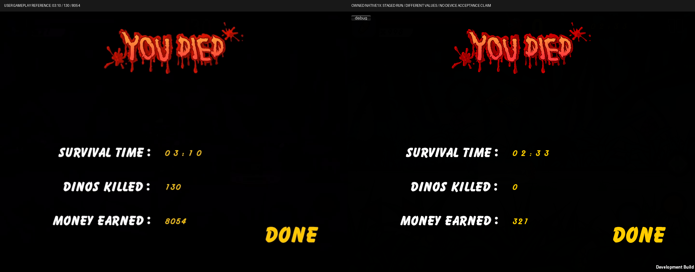

# 10. Jungle Blitz

> *AI-reviewed content: may change at any time and should not be fully trusted. See the [disclaimer](../start/disclaimer.md).*

> **In simple terms.** Jungle Blitz is the survival mode: a side-scrolling jungle where dinosaurs keep coming, pick-ups
> drop, and your result is kills and time survived. It is a separate scene with its own timers; only money and lives
> are carried over from City Grind, in memory.

- **Controls.** The mode is built into the same controller class as City Grind, so the shoot, melee and weapon keys come
  from the same input code. Doors do not exist here. Key-by-key confirmation inside Jungle is still to be done.
- **World.** The background wraps every 1023 units, origin starting at −512. Walkers enter from the sides; jumpers use
  set jump bounds.
- **Difficulty** rises with elapsed time using the original's tier thresholds (31, 61 and 151 seconds) and, after 150
  seconds, a divisor of 30. A fourth dinosaur type is armed with a 9999-second timer when the last tier starts at
  151 s (strictly after 150 s), so the ideal uninterrupted deadline is **10150 seconds** (about 2 h 49 min): effectively
  disabled, but reachable.
- **Pick-ups** follow the original's inventory rules: a higher weapon family always equips; a redundant weapon turns
  into random ammo. One upward notification shows ammo gains.
- **Scoring.** The original submits scores to Game Center, inactive offline; the port invents no local leaderboard.
  The results screen shows shared cash.
- **Music.** Jungle uses background track 2; City keeps track 1.
- **Status.** Implemented and covered by the broad automated run (922 of 922 at that point); owner acceptance on device
  is still open.

*Figure 05. Jungle Blitz results screen: a user gameplay recording (left) against a staged run of the port (right). Layout and fonts are compared; the numbers differ because the port run was staged. This is not a device-acceptance claim. Source: N2.54 Jungle results comparison (existing report image; not newly captured).*

Evidence: registry `jungle.*`; Reports Task003, Task008, N2.54.
